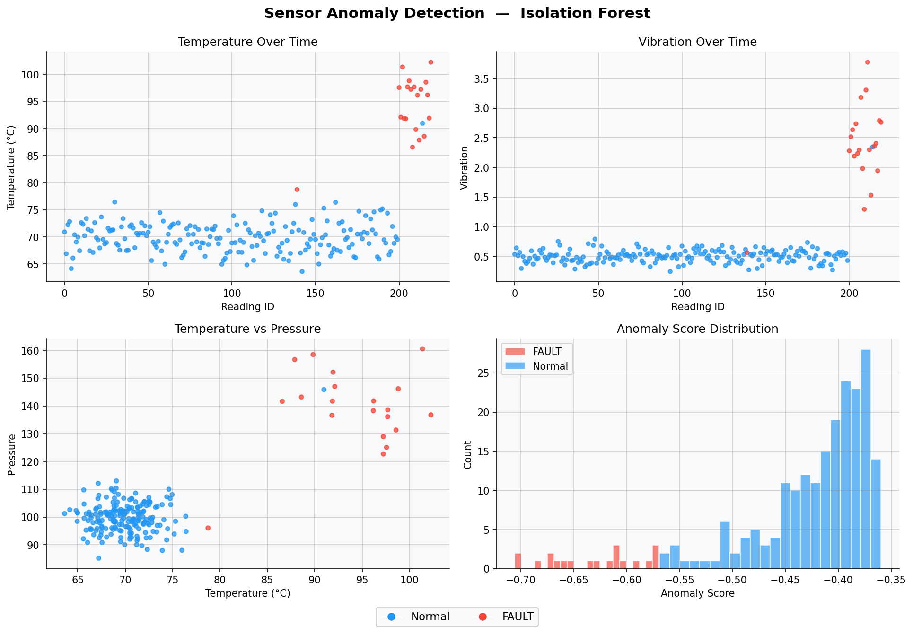

# Sensor Anomaly Detection


Unsupervised anomaly detection for industrial equipment using multivariate sensor data. Detects fault conditions from temperature, vibration, and pressure readings — **no labelled training data required**.

---

## Demo



*4-panel dashboard: time-series traces (top), feature scatter and anomaly score distribution (bottom). Red = detected fault, blue = normal.*

---

## How It Works

The pipeline has four stages:

```
Raw Sensor Data  →  StandardScaler  →  Isolation Forest  →  Labelled Output + Dashboard
```

| Stage | Description |
|---|---|
| **Data generation** | Simulates 200 normal + 20 fault readings across 3 sensors |
| **Feature scaling** | `StandardScaler` normalises each sensor channel to unit variance |
| **Isolation Forest** | Unsupervised ensemble that isolates outliers by random partitioning |
| **Evaluation** | Precision / Recall / F1 computed against known ground truth |

**Why Isolation Forest?**
Real industrial deployments rarely have labelled fault data. Isolation Forest operates without labels and scales to high-dimensional sensor streams. It builds random trees and scores points by how quickly they get isolated — anomalies are isolated fastest.

---

## Results

| Metric | Value |
|---|---|
| Total readings | 220 |
| True faults in data | 20 |
| Detected faults | 20 |
| Avg fault temperature | 94.0 °C |
| Avg normal temperature | 70.0 °C |
| **Precision** | **95.0%** |
| **Recall** | **95.0%** |
| **F1 Score** | **95.0%** |

---

## Project Structure

```
sensor-anomaly-detection/
├── sensor_project.py   # Full pipeline: data → model → visualisation → report
├── sensor_chart.png    # Generated diagnostic dashboard
├── requirements.txt
└── README.md
```

---

## Quick Start

```bash
# 1. Clone and enter the repository
git clone https://github.com/salamon30/sensor-anomaly-detection.git
cd sensor-anomaly-detection

# 2. Create a virtual environment and install dependencies
python3 -m venv .venv
source .venv/bin/activate
pip install -r requirements.txt

# 3. Run with default settings
python sensor_project.py

# 4. Or customise parameters via CLI
python sensor_project.py --n-normal 500 --n-faults 50 --contamination 0.09 --output dashboard.png
```

### CLI Options

| Flag | Default | Description |
|---|---|---|
| `--n-normal` | `200` | Number of normal readings to generate |
| `--n-faults` | `20` | Number of fault readings to inject |
| `--contamination` | `0.09` | Expected fraction of anomalies (0–0.5) |
| `--seed` | `42` | Random seed for reproducibility |
| `--output` | `sensor_chart.png` | Output path for the dashboard image |

---

## Tech Stack

| Library | Purpose |
|---|---|
| `scikit-learn` | Isolation Forest model, StandardScaler |
| `NumPy` | Random data generation, array operations |
| `Pandas` | Tabular data management |
| `Matplotlib` | 4-panel diagnostic visualisation |

---

## Real-World Applications

This pattern is used in production across:

- **Industrial automation** — predictive maintenance on CNC machines, conveyor belts (Siemens, ABB)
- **Automotive** — engine and transmission monitoring (BMW, Bosch)
- **Medical devices** — detecting out-of-range sensor behaviour in diagnostic equipment (Roche, Siemens Healthineers)
- **Energy** — turbine and compressor health monitoring

---

## Author

**Recep Uzun** — AI Master's Student @ Deggendorf Institute of Technology

[](https://github.com/salamon30)
